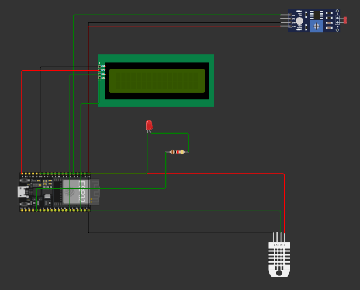
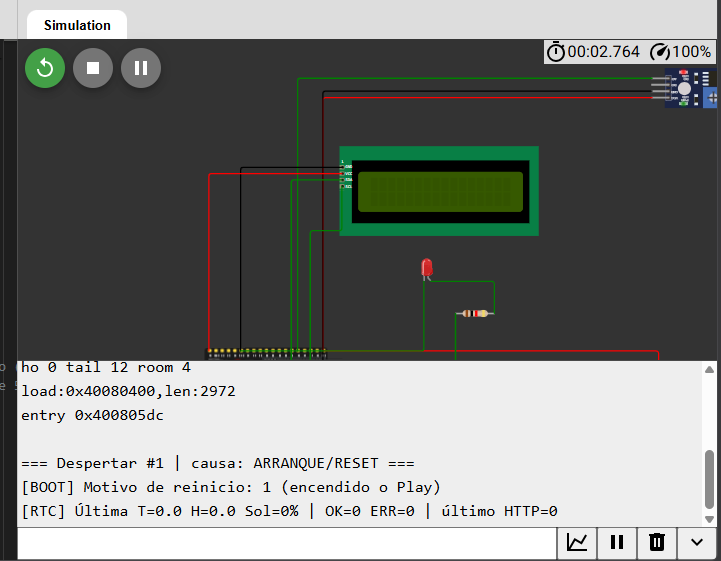
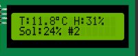
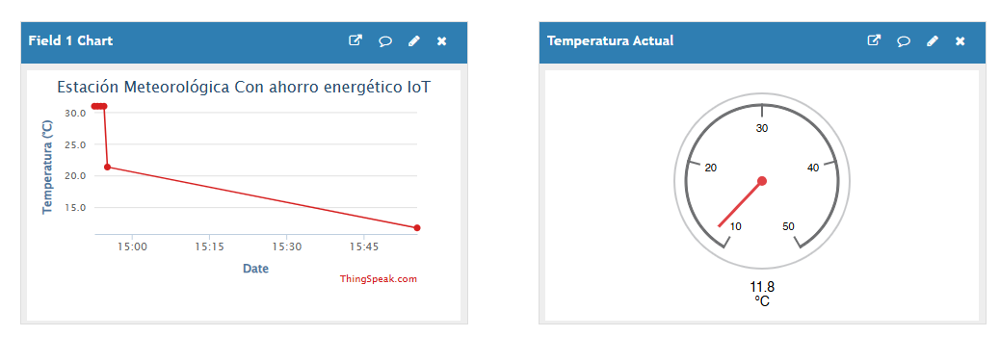

# Estación Meteorológica con Ahorro Energético mediante Deep Sleep

Estación meteorológica IoT basada en **ESP32** que mide temperatura, humedad y nivel de luz, muestra los datos en una pantalla LCD, los envía a **ThingSpeak** por **HTTP POST** y entra en **Deep Sleep** hasta el siguiente ciclo. Las variables de estado se conservan en la **memoria RTC** entre despertares.

Proyecto Integrador Final IoT & Web 4.0, Módulo 4.
Autor: José Luis Hernández González

- Proyecto en Wokwi: **[https://wokwi.com/projects/479614206663362561]**
- Dashboard en ThingSpeak: **[https://thingspeak.mathworks.com/channels/3563466]**

---

## Problema que resuelve

Las estaciones meteorológicas instaladas en zonas remotas dependen de baterías o paneles solares pequeños. Si el microcontrolador permanece activo todo el tiempo, consume demasiada energía y la estación se queda sin batería.

La solución mantiene el ESP32 en Deep Sleep la mayor parte del tiempo. Despierta solo para medir, mostrar los datos, enviarlos a la nube y volver a dormir.

## Características

- Lectura de temperatura y humedad (DHT22) y nivel de radiación solar (LDR, 0 a 100 %).
- Despliegue local en LCD I2C 16x2 durante 10 segundos.
- Envío por HTTP POST a ThingSpeak, con reintentos y clasificación de errores HTTP.
- Reconexión WiFi automática, con caché de canal y BSSID en memoria RTC.
- Deep Sleep con RTC Timer Wakeup, descontando el tiempo activo del periodo.
- Estadísticas de ejecución conservadas en memoria RTC.
- LED indicador: 2 parpadeos = envío exitoso, 5 parpadeos = error.

## Arquitectura

```
DHT22 ──┐
        ├──► ESP32 ──► LCD I2C (datos durante 10 s)
LDR ────┘      │
               ├──► LED de estado
               ├──► WiFi ──► HTTP POST ──► ThingSpeak (dashboard)
               └──► Memoria RTC + Deep Sleep (temporizador RTC)
```

Ciclo de cada despertar:

1. El temporizador RTC despierta al chip y se incrementa `contadorDespertares`.
2. Se inicializan LCD, DHT22 y la lectura del LDR.
3. Se leen los sensores y se guardan los últimos valores en memoria RTC.
4. Se muestran los datos en el LCD mientras se conecta el WiFi y se envía el POST.
5. El LED indica el resultado y se actualizan las estadísticas de envíos.
6. Se completan 10 segundos de pantalla, se apagan LCD y WiFi, y el chip entra en Deep Sleep.

## Lista de materiales (BOM)

| Componente | Función | Cantidad |
|---|---|---|
| ESP32 (DevKit C V4 en Wokwi) | Microcontrolador con WiFi y Deep Sleep | 1 |
| Sensor DHT22 | Temperatura y humedad | 1 |
| Módulo fotorresistencia LDR | Nivel de radiación solar (salida analógica AO) | 1 |
| Pantalla LCD 16x2 con interfaz I2C | Despliegue local de métricas | 1 |
| LED rojo | Indicador de estado del envío | 1 |
| Resistencia de 220 Ω a 1 kΩ | Limitar la corriente del LED | 1 |

## Conexiones

| Componente | Pin del componente | Pin del ESP32 |
|---|---|---|
| DHT22 | VCC | 3V3 |
| DHT22 | SDA (datos) | GPIO 15 |
| DHT22 | GND | GND |
| LDR (módulo) | VCC | 3V3 |
| LDR (módulo) | AO | GPIO 34 |
| LDR (módulo) | GND | GND |
| LCD I2C | VCC | 5V (VIN) |
| LCD I2C | SDA | GPIO 21 |
| LCD I2C | SCL | GPIO 22 |
| LCD I2C | GND | GND |
| Resistencia | Extremo 1 | GPIO 2 |
| Resistencia | Extremo 2 | Ánodo (A) del LED |
| LED | Cátodo (C) | GND |

El LDR usa el GPIO 34 porque es un pin ADC1, que sigue funcionando con el WiFi activo. El LED comparte el GPIO 2 con el LED integrado de la placa.

## Cómo ejecutarlo en Wokwi

1. Abre el proyecto desde el enlace de Wokwi de la parte superior.
2. Revisa que `libraries.txt` contenga:
   ```
   DHT sensor library
   Adafruit Unified Sensor
   LiquidCrystal I2C
   ```
3. En `sketch.ino`, pega tu Write API Key de ThingSpeak en `TS_API_KEY`.
4. Deja `WIFI_PASS` vacío: la red virtual `Wokwi-GUEST` no usa contraseña.
5. Pulsa **Play**.
6. Para cambiar los valores medidos, haz clic en el DHT22 o en el módulo LDR durante la simulación.

## Configuración de ThingSpeak

1. Crea una cuenta en [thingspeak.com](https://thingspeak.com) y un canal nuevo.
2. Define los campos:

| Campo | Nombre | Contenido |
|---|---|---|
| Field 1 | Temperatura | Grados Celsius |
| Field 2 | Humedad | Porcentaje |
| Field 3 | Radiacion Solar | Porcentaje (0 a 100) |
| Field 4 | Despertares | Contador de despertares |

3. Copia la **Write API Key** desde la pestaña **API Keys**.
4. En **Private View** agrega gráficas, un Gauge de temperatura y un Numeric Display de despertares.

El plan gratuito exige al menos 15 segundos entre envíos.

## Configuración del firmware

El código tiene dos constantes:

| Constante | Valor | Efecto |
|---|---|---|
| `SIMULADOR_WOKWI` | `1` | Adaptación para Wokwi: duerme en tramos de 1 segundo, porque el simulador reinicia el chip con sueños largos. No ahorra energía real |
| `SIMULADOR_WOKWI` | `0` | Diseño para hardware: un único sueño largo |
| `MODO_PRUEBA` | `1` | Periodo de 20 segundos, para demostraciones |
| `MODO_PRUEBA` | `0` | Periodo de 5 minutos, configuración final |

Variables en memoria RTC:

```cpp
RTC_DATA_ATTR int   contadorDespertares = 0;
RTC_DATA_ATTR float ultimaTemperatura   = 0;
RTC_DATA_ATTR float ultimaHumedad       = 0;
RTC_DATA_ATTR int   ultimoNivelSolar    = 0;
```

Para usarlo en una placa real con Arduino IDE o PlatformIO: instala las tres librerías, selecciona la placa ESP32 que corresponda, cambia `WIFI_SSID` y `WIFI_PASS` por los de tu red y ajusta `SIMULADOR_WOKWI` a `0`. Revisa también la dirección I2C del LCD (`0x27` por defecto; algunos módulos usan `0x3F`). Esta configuración no se ha probado en hardware físico.

## Salida esperada en la consola serie

```
=== Despertar #1 | causa: ARRANQUE/RESET ===
[BOOT] Motivo de reinicio: 1 (encendido o Play)
[SENSORES] T=11.8 C | H=31.0 % | Sol=45 % | DHT OK
[WiFi] Intento 1/2
[WiFi] Conectado. IP: 10.10.0.2 | RSSI: -86 dBm
[HTTP] Respuesta ThingSpeak: 41
[HTTP] Intento 1/3 -> código 200
[SLEEP] Activo 11.4 s. Durmiendo 8.6 s. Despertares: 1

=== Despertar #2 | causa: TIMER RTC ===
[RTC] Última T=11.8 H=31.0 Sol=45% | OK=1 ERR=0 | último HTTP=200
```

El segundo despertar muestra los valores del ciclo anterior, lo que confirma que la memoria RTC se conservó.

## Capturas


### Circuito en Wokwi


### Consola serie


### Pantalla LCD


### Dashboard en ThingSpeak


## Estimación de consumo (teórica)

El simulador no mide corriente. Estas cifras son estimaciones a partir de valores típicos del ESP32 (unos 120 mA con WiFi activo y unos 10 µA del chip en Deep Sleep) y no son mediciones.

| Tiempo activo por ciclo | Consumo diario aproximado (ciclo de 5 min) | Autonomía aproximada con batería de 3000 mAh |
|---|---|---|
| 15 s (con LCD 10 s) | 144 mAh | 20 días |
| 5 s (sin pantalla fija) | 48 mAh | 60 días |
| Siempre activo, sin Deep Sleep | 2900 mAh | 1 día |

La placa de desarrollo completa consume bastante más dormida que el chip solo, por el convertidor USB y el regulador. Para un despliegue real se recomienda un módulo ESP32 sin USB, con un regulador de bajo consumo en reposo.

## Limitaciones

- **Adaptación al simulador:** con `SIMULADOR_WOKWI 1` el chip despierta cada segundo y no refleja el ahorro de energía real. El ahorro corresponde a `SIMULADOR_WOKWI 0`, que no se ha verificado en hardware.
- **Radiación solar:** el LDR da un índice relativo de luz (0 a 100 %), no una medida en W/m². Para medir radiación real haría falta un sensor calibrado.
- **Seguridad:** la conexión HTTPS usa `setInsecure()`, es decir, no valida el certificado del servidor. Es aceptable en un prototipo, pero no en producción.
- **Límite de ThingSpeak:** el plan gratuito exige 15 segundos entre envíos.

## Seguridad de la clave

La `TS_API_KEY` del código del repositorio debe quedar con el texto de relleno `PEGA_AQUI_TU_WRITE_API_KEY`. No subas nunca la clave real. Si la expusiste por error, genera una nueva en ThingSpeak (**API Keys → Generate New Write API Key**).

## Estructura del repositorio

```
estacion-meteorologica-deep-sleep/
├── README.md
├── firmware/
│   └── estacion_meteorologica/
│       └── estacion_meteorologica.ino
├── wokwi/
│   ├── diagram.json
│   └── libraries.txt
├── docs/
│   └── capturas/
└── .gitignore
```

El archivo `.ino` va dentro de una carpeta con su mismo nombre para que Arduino IDE lo abra sin problemas.
